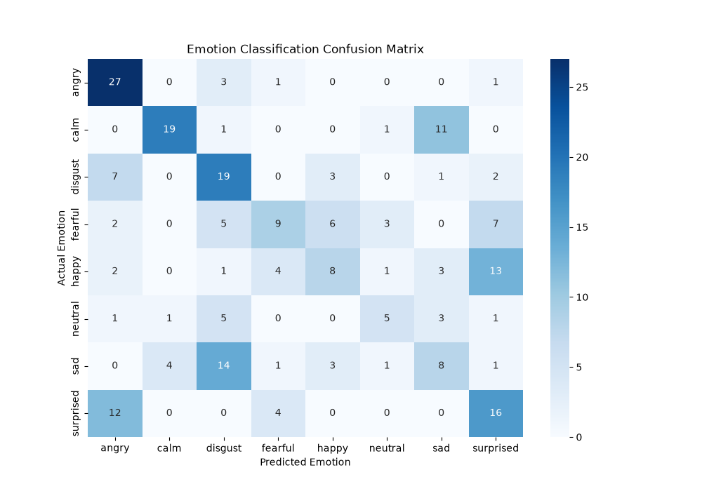

# Voice Emotion Analysis

Speaker-independent speech emotion recognition on RAVDESS, built with classical audio features (MFCC, deltas, RMS, ZCR) and a Random Forest classifier, evaluated with leave-one-speaker-out cross-validation to avoid speaker leakage.

## Overview

- **Task:** 8-class emotion classification from speech (angry, calm, disgust, fearful, happy, neutral, sad, surprised).
- **Dataset:** [RAVDESS](https://www.kaggle.com/datasets/uwrfkaggler/ravdess-emotional-speech-audio) — 1,440 WAV clips across 24 actors, downloaded automatically via `kagglehub`.
- **Features:** 13 MFCCs + delta + delta² (mean & std of each → 78 dims) plus RMS energy and zero-crossing rate (mean & std → 4 dims) = **82-dim feature vector per clip**.
- **Model:** `RandomForestClassifier(n_estimators=300, class_weight="balanced", oob_score=True, random_state=42)`.
- **Evaluation:** Actors 21–24 are held out entirely as a test set. The remaining actors (1–20) are evaluated with **Leave-One-Group-Out (LOGO)** cross-validation, grouped by actor ID, so no speaker ever appears in both the train and validation fold of a given split.

This feature set (MFCC + deltas + RMS + ZCR) is the result of a 16-way ablation study that also tried spectral centroid and bandwidth, individually and in combination — see [Feature ablation](#feature-ablation-how-this-config-was-chosen) below.

## Results (final model)

| Metric | Score |
|---|---|
| Speaker-independent CV accuracy (LOGO, actors 1–20) | 46.75% (± 10.37%) |
| Held-out test accuracy (actors 21–24, n=240) | 46% |

**Per-class performance on the held-out test set:**

| Emotion | Precision | Recall | F1 | Support |
|---|---|---|---|---|
| angry | 0.53 | 0.84 | 0.65 | 32 |
| calm | 0.79 | 0.59 | 0.68 | 32 |
| disgust | 0.40 | 0.59 | 0.47 | 32 |
| fearful | 0.47 | 0.28 | 0.35 | 32 |
| happy | 0.40 | 0.25 | 0.31 | 32 |
| neutral | 0.45 | 0.31 | 0.37 | 16 |
| sad | 0.31 | 0.25 | 0.28 | 32 |
| surprised | 0.39 | 0.50 | 0.44 | 32 |
| **accuracy** | | | **0.46** | 240 |
| macro avg | 0.47 | 0.45 | 0.44 | 240 |
| weighted avg | 0.47 | 0.46 | 0.45 | 240 |



**Key finding:** `calm` (0.68 F1) and `angry` (0.65 F1) are the strongest classes; `sad` is persistently confused with `disgust`, and `surprised` with `angry`. This pattern holds across every one of the 16 feature combinations tested, suggesting these pairs share overlapping prosodic/spectral statistics that clip-level summary features can't separate.

## Feature ablation (how this config was chosen)

Before settling on MFCC+deltas+RMS+ZCR, 16 feature combinations were benchmarked (baseline MFCC+deltas, plus spectral centroid, bandwidth, RMS, and ZCR added individually and in every combination), each evaluated with the same actor-grouped LOGO cross-validation and held-out test split.

| # | Feature combination | CV accuracy (mean ± std) | Test accuracy (n=240) |
|---|---|---|---|
| 1 | baseline (MFCC + deltas only) | 47.17% (± 9.82%) | 40% |
| 2 | baseline + centroid | 47.25% (± 10.83%) | 43% |
| 3 | baseline + bandwidth | **48.25%** (± 9.85%) | 42% |
| 4 | baseline + rms | 46.08% (± 10.45%) | 43% |
| 5 | baseline + zcr | 46.92% (± 9.16%) | 40% |
| 6 | baseline + centroid + bandwidth | 46.83% (± 10.05%) | 43% |
| 7 | baseline + centroid + rms | 45.67% (± 11.14%) | 45% |
| 8 | baseline + centroid + zcr | 47.50% (± 10.49%) | 42% |
| 9 | baseline + centroid + bandwidth + rms | 45.75% (± 10.81%) | 45% |
| 10 | baseline + centroid + bandwidth + zcr | 47.00% (± 9.30%) | 44% |
| 11 | baseline + centroid + rms + zcr | 46.75% (± 9.70%) | 45% |
| 12 | baseline + bandwidth + rms | 45.25% (± 11.18%) | 44% |
| 13 | baseline + bandwidth + zcr | 47.58% (± 9.55%) | 43% |
| **14** | **baseline + rms + zcr (shipped config)** | 46.75% (± 10.37%) | **46%** |
| 15 | baseline + bandwidth + rms + zcr | 46.83% (± 10.72%) | 44% |
| 16 | baseline + centroid + bandwidth + rms + zcr (all) | 46.33% (± 9.97%) | 45% |

**Takeaway:** speaker-independent CV stayed essentially flat across all 16 combinations (45.3%–48.3%, ±9–11% speaker std) regardless of which spectral features were added. Run 14 (shipped) has the best test accuracy, but its CV score (46.75%) doesn't actually beat the baseline's CV (47.17%) — so that test-set gain isn't fully corroborated by cross-validation. This points to a ceiling for clip-level summary-statistic features on this task; the natural next step is temporal/sequence modeling (e.g. LSTM or 1D-CNN over frame-level features) rather than more hand-crafted aggregate features.

Full per-run classification reports and confusion matrices for all 16 combinations are in **`output_analysis.docx`**.

> **Note on reproducibility:** `mfcc_features.py` on `main` implements only the shipped configuration (MFCC+deltas+RMS+ZCR, run 14) — it doesn't expose toggles for centroid/bandwidth. The other 15 combinations were produced with modified versions of the feature-extraction step during the ablation and aren't included as a runnable script in this repo; `output_analysis.docx` is the record of that study.

## Repository structure

```
.
├── audit_dataset.py       # Sanity-checks the downloaded RAVDESS files: counts per emotion, flags invalid filenames
├── load_audio.py          # Loads a WAV file and trims leading/trailing silence (librosa, top_db=20)
├── mfcc_features.py       # Extracts the 82-dim feature vector (MFCC+deltas, RMS, ZCR) for one clip
├── process_all.py         # Downloads RAVDESS via kagglehub, runs the above on every file, saves X_data.npy / y_data.npy / actors_data.npy
├── test_train_split.py    # Splits data by actor ID: actors 21-24 held out as test, 1-20 as train
├── cross_validation.py    # Leave-One-Group-Out CV (grouped by actor) on the training set
├── evaluate_matrix.py     # Prints the classification report and plots the confusion matrix
├── run_experiment.py      # Entry point: loads saved features, splits, cross-validates, trains, evaluates
├── confusion_matrix.png   # Confusion matrix for the shipped model (actors 21-24 test set)
├── output_analysis.docx   # Full write-up of the 16-combination feature ablation
└── requirements.txt
```

## Setup

```bash
pip install -r requirements.txt
```

The dataset is fetched automatically by `kagglehub` on first run. If you haven't used `kagglehub` before, it may prompt you to authenticate with a Kaggle account (API token at `~/.kaggle/kaggle.json`).

## Usage

```bash
# 1. (Optional) Sanity-check the dataset download
python audit_dataset.py

# 2. Extract features for every clip and cache them to disk
python process_all.py

# 3. Run cross-validation + held-out evaluation
python run_experiment.py
```

`run_experiment.py` will print the LOGO cross-validation accuracy, the held-out test classification report, and display the confusion matrix plot.

## Limitations & next steps

- Clip-level summary statistics (mean/std of MFCC, RMS, ZCR) appear to have hit an accuracy ceiling around 45–48% CV on this dataset — adding more hand-crafted spectral features doesn't move the needle (see ablation above).
- `sad`/`disgust` and `surprised`/`angry` remain the hardest pairs to separate; this likely needs features that capture pitch contour and timing dynamics rather than clip-wide averages.
- Next step under consideration: sequence models (LSTM / 1D-CNN) over frame-level features instead of summary statistics.
